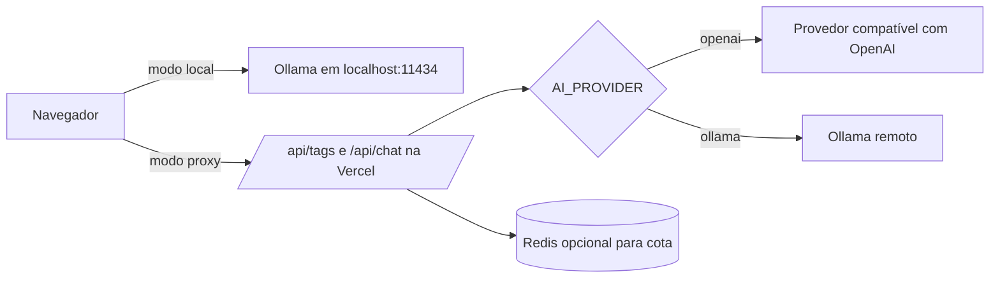

# Auditoria inicial — Chess-Analysis

**Data:** 16/11/2026  
**Fase:** 0 — diagnóstico, proteção de dados e decisão arquitetural  
**Aplicação publicada:** https://chessanalysis-murex.vercel.app  
**Repositório:** `https://github.com/AdemisCst/chessanalysis`  
**Branch de trabalho:** `fase-1-estabilizacao`  
**Linha de base:** commit `b0d336e`, tag `fase-0-baseline`

> Este documento registra o estado **real e verificado** do projeto antes das
> alterações da Fase 1. Onde não houve verificação, o texto indica
> explicitamente “não verificado”. Nenhuma hipótese é apresentada como fato.
>
> **Atualização da Fase 1:** a fotografia abaixo continua sendo a linha de base
> (`fase-0-baseline`). As correções de identidade, navegação, privacidade da IA,
> relatório/PDF e testes estão registradas em
> [`docs/TESTES-FASE-1.md`](TESTES-FASE-1.md) e
> [`docs/ARQUITETURA-INTEGRACAO.md`](ARQUITETURA-INTEGRACAO.md).
>
> **Atualização da Fase 2 (17/11/2026):** a versão do motor foi confirmada por
> leitura dos arquivos vendorizados e o diagnóstico completo está na
> [§12](#12-fase-2--auditoria-do-motor-17112026). Isso resolve a pendência
> “Confirmar versão do Stockfish” da §10; as demais pendências continuam como
> estavam.

---

## 1. Legenda de estados

| Estado | Significado |
|---|---|
| **Verificado** | Confirmado por leitura do código ou execução real. |
| **Não verificado** | Existe no código, mas não foi executado nesta auditoria. |
| **Desconhecido** | Não há informação suficiente no repositório ou no ambiente. |
| **Limitação** | Comportamento conhecido e restrito por decisão técnica. |
| **Bloqueado** | Depende de dado, credencial ou acesso externo. |

---

## 2. Estrutura real do projeto

```text
Chess/
├── api/
│   ├── _lib.js              utilidades do proxy (CORS, cota, Redis, provedores)
│   ├── chat.js              proxy de conversa em streaming (Edge)
│   └── tags.js              status/modelos do assistente (Edge)
├── docs/                    criado na Fase 0/1
├── js/
│   ├── ai.js                cliente da IA e montagem de prompts
│   ├── analytics.js         estatísticas, aberturas, leitura e repertório
│   ├── app.js               estado global, navegação, tema, modais e init
│   ├── board.js             renderização do tabuleiro
│   ├── engine.js            Stockfish (Web Worker), avaliação e anotações
│   ├── game.js              tela da partida, abas, análise, tags e PDF
│   ├── library.js           importação PGN, filtros, tabela e exportação
│   ├── openings.js          reconhecimento de aberturas (base Lichess/ECO)
│   ├── pgn-worker.js        leitura de PGN em Web Worker
│   ├── pgn.js               parser/serializador PGN
│   ├── samples.js           partidas de exemplo
│   ├── settings.js          ajustes, backup, restauração e análise em lote
│   ├── stats.js             identidade provisória e cálculos estatísticos
│   ├── storage.js           IndexedDB e preferências em localStorage
│   └── tags.js              tags fixas por lado
├── tools/
│   └── check-syntax.cjs     verificação de sintaxe sem dependências
├── vendor/
│   ├── chess.js             biblioteca de regras
│   ├── eco/                 base de aberturas e scripts de geração
│   ├── pieces/              peças SVG
│   └── stockfish/           Stockfish.js + WASM + licença GPLv3
├── index.html               aplicação de página única (shell atual)
├── style.css                estilos e tema
├── servidor.ps1             servidor HTTP local (porta 8765)
├── iniciar.bat              atalho do servidor local
├── vercel.json              headers e configuração de deploy
├── package.json             scripts locais, sem dependências de build
├── .env.example             modelo de variáveis (atualmente ignorado pelo Git)
└── LEIA-ME.md               documentação de uso
```

### 2.1. Dependências

| Dependência | Versão/identificação | Estado |
|---|---|---|
| chess.js | 0.10.3 (informado no LEIA-ME; o arquivo vendorizado não expõe versão no cabeçalho) | **Verificado no uso**; versão exata não confirmada no arquivo |
| Stockfish.js | distribuição `nmrugg/stockfish.js`; build de **02/08/2019** (Stockfish 10), conforme §12 | **Verificado na Fase 2**; o rótulo do código estava correto |
| Stockfish WASM | `vendor/stockfish/stockfish.wasm` (366.900 bytes) + `stockfish.asm.js` (957.535 bytes, não usado) | **Verificado na Fase 2** (tamanhos e conteúdo) |
| Base ECO/Lichess | `vendor/eco/openings.json` (~522 KB) | **Verificado** |
| Peças cburnett | SVGs em `vendor/pieces` | **Verificado** |
| Node.js | servidor local e scripts de verificação | **Verificado** (ambiente de desenvolvimento) |
| Vercel Functions | runtime Edge em `api/chat.js` e `api/tags.js` | **Verificado no código**; deploy não revalidado nesta etapa |
| Upstash Redis | opcional, para cotas/cache | **Não configurado** no `.env` local |

Não há React, Next.js, Angular, Vue, TypeScript, Python ou PHP no frontend.

---

## 3. Funcionalidades existentes

### 3.1. Biblioteca e PGN

| Funcionalidade | Estado | Observação |
|---|---|---|
| Importação por arquivo | **Verificado no código** | `fileInput`, múltiplos arquivos `.pgn`/`.txt` |
| Importação por arrastar/soltar | **Verificado no código** | `#dropZone`; será removida por requisito |
| Múltiplas partidas por arquivo | **Verificado** | `PGN.splitGames` |
| Leitura em Web Worker | **Verificado no código** | `js/pgn-worker.js`, fallback para a thread principal |
| Detecção de duplicatas | **Verificado no código** | IDs determinísticos por jogadores/resultado/lances |
| Importação de cópias | **Verificado no código** | sufixo `_c2`, `_c3`… |
| Filtros por texto e campos | **Verificado no código** | `white:`, `black:`, `result:`, `eco:`, `elo>=` etc. |
| Favoritos, tags e seleção múltipla | **Verificado no código** | |
| Exportação PGN/JSON | **Verificado no código** | nomes de arquivo ainda usam `acervo64` |
| Comentários e variantes do PGN | **Limitação** | O parser ignora `{ }`, `;`, `( )` e NAGs; o PGN é reserializado apenas com a linha principal |
| Preservação do PGN original bruto | **Limitação** | `game.pgn` é gerado a partir dos lances validados, não é o texto original |

### 3.2. Partida e análise

| Funcionalidade | Estado | Observação |
|---|---|---|
| Tabuleiro e navegação por lances | **Verificado no código** | setas, Home/End, clique na lista |
| Abas Lances/Análise/IA | **Verificado no código** | `setPly` não troca de aba; falta teste de regressão formal |
| Avaliação com Stockfish | **Verificado no código** | Web Worker, UCI, profundidade configurável |
| Anotações e precisão | **Verificado no código** | 7 categorias na versão atual, ordem divergente do Prompt Mestre |
| Momentos-chave e gráfico | **Verificado no código** | SVG gerado no navegador |
| Relatório PDF | **Verificado no código** | impressão de HTML; não é um PDF completo e ainda não foi testado como arquivo |
| Persistência da análise | **Verificado no código** | store `analysis`, chave `gameId@depth` |
| Reanálise e enriquecimento | **Verificado no código** | `Engine.enrichAnalysis` |
| Análise em lote | **Verificado no código** | modal sequencial; não é a Central de Análises da Fase 3 |
| Retomada após fechar a página | **Limitação** | Não existe fila/checkpoint persistente; trabalho em lote é perdido |

### 3.3. Desempenho e IA

| Funcionalidade | Estado | Observação |
|---|---|---|
| Estatísticas | **Verificado no código** | precisão, ACPL, fases, cores, controles, rating |
| Aberturas | **Verificado no código** | base local, maior prefixo |
| Identificação do jogador | **Implementação provisória** | `Stats.identifyPlayer` tenta nomes e, se vazio, deduz por frequência; não é `PlayerIdentity` |
| Leitura do acervo | **Verificado no código** | IA ou fallback local determinístico |
| Repertório sugerido | **Verificado no código** | IA ou fallback local |
| Chat | **Desativado na interface** | bloco oculto; funções permanecem no código |
| Consentimento antes de envio | **Não implementado** | Envio ocorre sem modal de autorização |
| Minimização/desidentificação | **Não implementado** | Nomes, evento, local e tags podem ser enviados no contexto |
| Indicador de provedor externo | **Não implementado** | Apenas chip de status online/offline |

---

## 4. IndexedDB e preferências

### 4.1. Banco

- Nome: `acervo64` (identificador legado).
- Versão: `1`.
- Stores:

| Store | Chave | Índices | Conteúdo |
|---|---|---|---|
| `games` | `id` | `dateISO`, `result`, `white`, `black`, `eco`, `event`, `year`, `favorite`, `maxElo`, `importedAt` | metadados da partida |
| `data` | `id` | — | `startFen`, lances com FEN, PGN serializado |
| `analysis` | `key` | `gameId` | posições, avaliações, anotações, precisão, ACPL, momentos |
| `ai` | `key` | `gameId` | resumos e tags gerados por IA |
| `meta` | `key` | — | marcadores de migração, insights e repertório |

### 4.2. Preferências

- Chave `localStorage`: `acervo64_settings_v1`.
- Campos: tema, nomes do perfil, profundidade, tamanho da página e configuração de IA.

### 4.3. Preservação

**Decisão:** o nome do banco e a chave de `localStorage` **não serão renomeados**
na Fase 1. Renomear sem migração apagaria a biblioteca existente para o
aplicativo. Esses nomes ficam documentados como identificadores legados de
compatibilidade. Apenas a interface, os textos e os nomes dos arquivos
exportados passam a usar “Chess-Analysis”.

### 4.4. Estado do backup

| Item | Estado |
|---|---|
| Cópia do código versionado | **Verificada**: ZIP em `C:\Users\ademi\AppData\Local\Temp\opencode\chess-analysis-baseline.zip` |
| Exportação JSON da biblioteca real | **Bloqueada**: depende de ação do usuário no navegador onde os dados existem |
| Teste de restauração com dados de exemplo | **Pendente** |
| Teste de restauração com dados reais | **Não executado** |

Não se afirma que o backup real foi validado.

---

## 5. Stockfish

> **Fase 2 (17/11/2026):** os itens abaixo são o retrato da Fase 0. A versão foi
> confirmada e o diagnóstico completo, com evidências, está na **§12**.

- Worker: `vendor/stockfish/stockfish.js`.
- WASM: `vendor/stockfish/stockfish.wasm`.
- Protocolo: UCI.
- Opções enviadas: `Hash=32`, `MultiPV=1`.
- Busca: `go depth <n>`, com timeout de 45 s por posição.
- Limite de inicialização: 25 s.
- A análise exige HTTP(S); em `file://` o app avisa e bloqueia.
- O código rotula o motor como “Stockfish 10 (WASM)”, mas **a versão do arquivo
  vendorizado não foi confirmada**. A versão de referência do Prompt Mestre
  (Stockfish 19) é uma proposta a validar, não uma versão instalada.
- Não há teste de posições de referência nem verificação de NNUE nesta fase.

---

## 6. Inteligência artificial

### 6.1. Arquitetura atual



- Cliente: `js/ai.js`.
- Proxy: `api/chat.js` e `api/tags.js`.
- Utilidades: `api/_lib.js`.
- Streaming: NDJSON no contrato do Ollama; SSE da OpenAI é convertido.
- Chave do provedor: somente no servidor.

### 6.2. Configuração local verificada

| Variável | Valor observado | Situação |
|---|---|---|
| `AI_ACCESS_MODE` | `code` | Incompatível com a interface, que não pede mais código |
| `AI_PROVIDER` | `openai` | Correto para provedor compatível |
| `AI_BASE_URL` | `https://api.deepseek.com/v1` | Provedor DeepSeek |
| `AI_MODEL` | `llama-3.3-70b-versatile` | Modelo da Groq, **não existe na DeepSeek** |
| `AI_API_KEY` | valor placebo iniciado por `sua_`, 14 caracteres | **Chave inválida** |
| `AI_DAILY_PER_USER` | `20` | Configurado |
| `AI_DAILY_GLOBAL` | `500` | Configurado |
| `AI_ACCESS_CODES` | 1 código | Será retirado com a remoção do código de acesso |

### 6.3. Diagnóstico do erro “Invalid API Key”

O erro é compatível com três problemas simultâneos:

1. a chave é um texto de exemplo, não uma credencial real;
2. o endpoint é da DeepSeek, mas o modelo configurado é da Groq;
3. `AI_ACCESS_MODE=code` exige um cabeçalho que a interface atual não envia.

Além disso, `/api/tags` não valida a credencial de provedores OpenAI: ele
devolve “online” apenas porque existe um modelo configurado. Por isso a
interface pode mostrar “Assistente pronto” e falhar somente no chat.

### 6.4. Produção

- A página publicada ainda exibe o HTML antigo: título “Organizador de
  Partidas”, dropzone, código de acesso e “Detalhes da conexão”.
- `GET https://chessanalysis-murex.vercel.app/api/tags` retornou **HTTP 401**
  na verificação desta auditoria.
- Conclusão: o deploy publicado não contém as mudanças locais e/ou as variáveis
  de produção continuam com o modo por código. Precisa ser revalidado após a
  correção.

---

## 7. Vercel

- `vercel.json`: `cleanUrls`, `trailingSlash=false`, cache para `vendor/` e
  headers de segurança básicos.
- Projeto vinculado em `.vercel/repo.json` (`chessanalysis`).
- CLI disponível: Vercel CLI 65.16.0.
- Não há `Content-Security-Policy` configurada.
- As funções usam runtime Edge.
- Não há teste automatizado de deploy no repositório.

---

## 8. Problemas e riscos identificados

| # | Problema | Gravidade | Estado |
|---|---|---|---|
| 1 | Chave/modelo de IA incoerentes e chave placebo | Alta | **Verificado** |
| 2 | Interface sem código, proxy exigindo código | Alta | **Verificado** |
| 3 | `/api/tags` não valida credencial OpenAI | Alta | **Verificado no código** |
| 4 | Envio à IA sem consentimento e sem minimização | Alta | **Verificado no código** |
| 5 | Documentação obrigatória ausente | Média | **Verificado** |
| 6 | Resíduos “Acervo 64” e subtítulo antigo | Média | **Verificado** |
| 7 | Dropzone, código de acesso, detalhes e frase de licenças ainda presentes | Média | **Verificado** |
| 8 | Menu com 6 áreas em vez de 5 | Média | **Verificado** |
| 9 | Ordem das anotações divergente | Média | **Verificado** |
| 10 | Painéis Leitura/Repertório empilhados | Baixa | **Verificado** |
| 11 | PDF incompleto e não testado como arquivo | Média | **Verificado** |
| 12 | Sem teste de regressão das abas | Média | **Verificado** |
| 13 | Sem fila/checkpoint persistente | Alta (Fase 3) | **Limitação conhecida** |
| 14 | Parser descarta comentários e variantes | Média | **Limitação conhecida** |
| 15 | Identidade provisória por nome/dedução | Alta (Fase 5) | **Limitação conhecida** |
| 16 | `.gitignore` ignora `.env.example` | Baixa | **Verificado** |
| 17 | Código e banco usam identificadores `acervo64` | Baixa | **Decisão de compatibilidade** |

---

## 9. Decisões já tomadas

1. **Arquitetura:** HTML multipágina + checkpoints persistentes + retomada
   confiável. Não será SPA.
2. **Fase 1:** estabilizar o shell atual antes da separação física das páginas.
3. **Dados:** preservar o banco `acervo64` e a chave de preferências existente.
4. **IA:** provedor DeepSeek; remover código de acesso; cota por IP; consentimento
   e minimização antes de envio externo.
5. **PDF:** manter e tornar robusto nesta fase, com relatório completo gerado a
   partir de dados reais, sem inventar variantes.
6. **Identidade:** `PlayerIdentity` será documentada na Fase 1 e implementada na
   Fase 5. Não inferir usernames por semelhança.
7. **Stockfish:** a versão real será validada na Fase 2; “Stockfish 19” é
   referência a validar, não versão confirmada.

---

## 10. Pendências e bloqueios da Fase 0

| Pendência | Estado | Como resolver |
|---|---|---|
| Exportar backup JSON da biblioteca real | **Bloqueado** | O usuário deve abrir o app no navegador com os dados e usar Ajustes → Backup completo |
| Testar restauração com dados de exemplo | **Pendente** | Executar no navegador de teste |
| Confirmar variáveis na Vercel | **Pendente** | Configurar DeepSeek e remover o modo por código |
| Confirmar versão do Stockfish | **Pendente** | Validar distribuição na Fase 2 |
| Testar deploy publicado | **Pendente** | Publicar e verificar `/`, `/api/tags` e `/api/chat` |

---

## 11. Critérios de conclusão da Fase 0

- [x] Inventário técnico suficiente e rastreável.
- [x] Cópia do código versionado criada e verificada.
- [x] Decisão arquitetural documentada.
- [ ] Backup da biblioteca real exportado e restauração verificada — **bloqueado
      até ação do usuário**.
- [x] Riscos e limitações registrados.
- [x] Nenhuma operação destrutiva executada.

---

## 12. Fase 2 — auditoria do motor (17/11/2026)

**Escopo:** inspeção de `js/engine.js` e de `vendor/stockfish/`, sem alterar
código. Diagnóstico de build, execução, protocolo UCI, classificação e riscos.

### 12.1. Arquivos inspecionados e caminhos inexistentes

| Caminho | Estado |
|---|---|
| `vendor/stockfish/stockfish.js` (62.385 bytes) | **Verificado** |
| `vendor/stockfish/stockfish.wasm` (366.900 bytes) | **Verificado** |
| `vendor/stockfish/stockfish.asm.js` (957.535 bytes) | **Verificado**; não referenciado por nenhum arquivo |
| `vendor/stockfish/LICENSE-GPLv3.txt` (35.147 bytes) | **Verificado** |
| `js/engine.js` (603 linhas) | **Verificado** |
| `public/assets/js/services/stockfish/` | **Não existe** |
| `engine/` | **Não existe** |
| `move-classification.js` | **Não existe** |

A classificação de lances não tem arquivo próprio: ela vive em `js/engine.js`
(`ANNOTATIONS`, `THRESHOLDS`, `decideAnnotation`, `buildAnalysis`).

### 12.2. Build e execução

| Item | Resultado | Evidência |
|---|---|---|
| Distribuição | `nmrugg/stockfish.js`, licença GPL | cabeçalho do `stockfish.js` (`/*! Stockfish.js ... License: GPL */`) |
| Data do build | **02/08/2019** | string `Aug  2 2019` dentro de `stockfish.wasm` |
| Versão | **Stockfish 10** | build de 2019 da referida distribuição; inclui variantes (`UCI_Variant`) |
| Rótulo do código | “Stockfish 10 (WASM)” | `js/engine.js:504` — **estava correto** |
| Execução | **Web Worker** | `worker = new Worker('vendor/stockfish/stockfish.js')` em `js/engine.js:112`, com `onmessage`/`postMessage` |
| Threads | **single-thread** | `_pthread_create` é stub (retorna 11) no binário |
| Fallback asm.js | **não ligado** | `stockfish.asm.js` não é citado em `js/engine.js` nem em qualquer outro arquivo; falha do WASM só dispara `worker.onerror` |

### 12.3. Comunicação UCI

Comandos efetivamente enviados (`js/engine.js`):

1. `uci`
2. `setoption name Hash value 32`
3. `setoption name MultiPV value 1`
4. `isready`
5. `ucinewgame`
6. `position fen <fen>`
7. `go depth <n>`
8. `stop` (cancelamento, timeout ou `Engine.stop()`)

| Pergunta | Resposta | Evidência |
|---|---|---|
| Envia `UCI_ShowWDL`? | **Não** | nenhuma ocorrência de `wdl`/`UCI_ShowWDL` no repositório, inclusive nos binários |
| Tem W/D/L do motor? | **Não** | a linha `info` é lida apenas para `score cp`/`score mate` |
| Tem centipeões? | **Sim** | `parseInfo`, `js/engine.js:66-78` |
| Tem Expected Score? | **Sim, derivado** | `whiteWinPct` aplica logística sobre cp: `50 + 50*(2/(1+exp(-0.00368208*cp))-1)` |

**Conclusão:** a probabilidade existente é um *Expected Score* heurístico
calculado no navegador a partir de centipeões — não é WDL do Stockfish.

### 12.4. Classificação atual

A perda usada nas anotações é medida em **pontos percentuais de vitória**, não
em centipeões (`loss = max(0, antes − depois)` em `js/engine.js:381-383`).

| Constante | Valor | Uso |
|---|---|---|
| `THRESHOLDS.blunder` | 30 | Capivarada a partir de 30 pp |
| `THRESHOLDS.mistake` | 10 | Erro entre 10 e 29,9 pp |
| `THRESHOLDS.excellent` | 2 | Excelente até 2 pp |
| `THRESHOLDS.missedBefore` / `missedAfter` / `missedFloor` | 80 / 70 / 45 | Chance perdida |
| `THRESHOLDS.sacrifice` / `brilliantAfter` / `brilliantFollow` | 2 / 60 / 55 | Brilhante por sacrifício |
| `THRESHOLDS.turnaroundBefore` / `turnaroundAfter` | 35 / 60 | Brilhante por virada |
| `THRESHOLDS.brilliantLoss` / `minPly` | 2 / 6 | Brilhante |

Prioridade de decisão (`js/engine.js:329-337`): Brilhante → Melhor → Chance
perdida → Capivarada → Erro → Excelente → Ótimo.

- Precisão: `clamp(103.1668 * exp(-0.04354 * loss) - 3.1669, 0, 100)` sobre a
  perda em pp.
- ACPL: `cpBefore − cpAfter` em centipeões, com mate achatado em ±1400.

**Limitação conceitual:** mate é convertido em ±1400 cp e o empate não é
modelado; a curva não é calibrada por WDL.

### 12.5. Riscos de front-end

| # | Risco | Gravidade | Evidência |
|---|---|---|---|
| R1 | Shape de `positions` é persistido no IndexedDB e lido pela barra de avaliação, gráfico, seta, tags e PDF | Alta | `js/game.js:162-201`, `js/game.js:302-306`, `js/report.js:102-103` |
| R2 | Estado único `active`: `bestmove` perdido deixa a busca pendente até o timeout de 45 s, que resolve com `cp: null` → 0 cp → 50% silencioso | Alta | `js/engine.js:195-206` |
| R3 | Paridade de índices (`i % 2`, `winForMover(i)`) assume sequência completa desde a posição inicial; análise parcial corrompe todas as anotações | Média/Alta | `js/engine.js:257-273`, `js/engine.js:378-384` |
| R4 | Parser por regex de texto UCI (`info ... score cp|mate ... pv`) deixa de pontuar sem erro visível se o formato mudar | Média | `js/engine.js:66-78` |
| R5 | `Engine.stop()` envia `stop` e chama `terminate()` imediatamente; a promessa pendente só é liquidada pelo timeout | Média | `js/engine.js:213-221` |
| R6 | `Cache-Control: immutable` de 1 ano em `/vendor/(.*)`: substituir o motor mantendo o mesmo nome de arquivo serve binário antigo para quem já visitou | Alta (na troca de motor) | `vercel.json:6-11` |

**Recomendação registrada:** qualquer campo novo deve ser **aditivo**
(`positions[i].wdl`), com `version` elevada e fallback para a curva atual quando
o WDL não existir.

### 12.6. O que não foi verificado nesta etapa

- Teste de posições de referência (perft/profundidade fixa) contra o binário.
- Desempenho real do build de 2019 em partidas longas.
- Comportamento em navegadores sem `WebAssembly`.
- Comparação numérica entre a curva atual e um WDL real.

Nada nesta seção foi declarado “aprovado”: são leituras de código e de binário.

**Plano de execução da Fase 2:** [`docs/PLANO-FASE-2.md`](PLANO-FASE-2.md).
